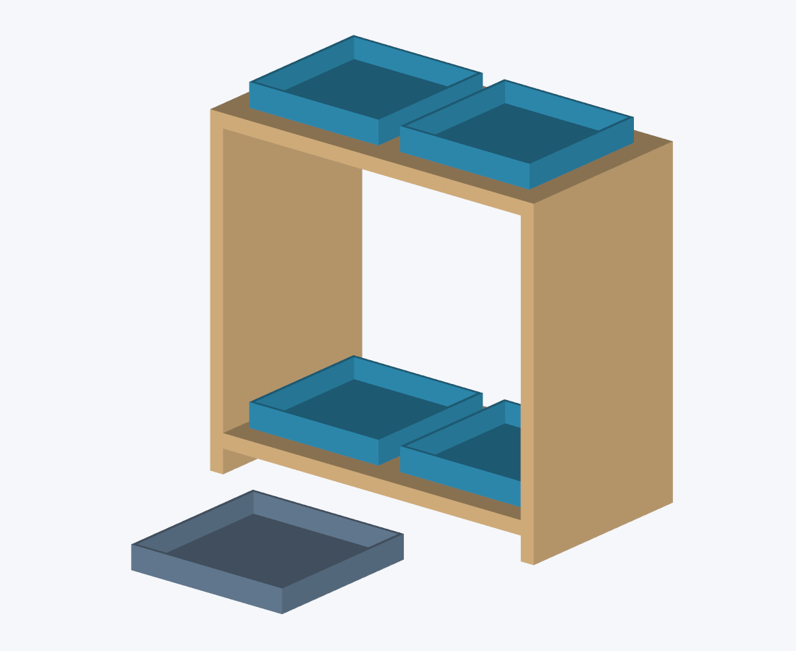

# Basic upright shelf

Frame: **300 × 160 × 280 mm** (width × depth × height), 300 mm high including bins. Two shelf boards, two sides, a rear brace, four 120 × 120 × 20 mm open-top bins and one 140 × 140 × 20 mm I/O tray.

Open [Shelf_classic.SLDASM](solidworks/Shelf_classic.SLDASM) in SolidWorks 2026. Keep the assembly and its five `.SLDPRT` files together. Components are fixed in position; imported solids have no native sketch history. Panels are intended as 12 mm plywood; bins and tray are printed.

Every native file has matching `.STEP` and `.STL` exports in [solidworks/](solidworks/). Open the [assembly STEP](solidworks/Shelf_classic.STEP) without SolidWorks, or preview the [assembly STL](solidworks/Shelf_classic.STL). Units are millimetres, Y is up. Assembly STL is an overview, not a print job; touching components are fused in that mesh only. For Bambu Studio, use the individual bin/tray STL at 100%, orient the floor onto the bed and select the actual printer/nozzle/material.

[Geometry and reach report](validation.json): five valid part types, ten non-interpenetrating components; exported STEP dimensions, volumes and placements match the native design, and all STL meshes are watertight. With the assumed robot base at (150, 0, 400) in the local X-width / Y-up / Z-front frame and an 18 mm part, the maximum assumed flange radius is 566.34 mm, within a 576 mm screening limit (626 mm nominal reach minus 50 mm reserve; 150 mm tool offset). This radial screen does not validate a trajectory or front-entry approach.

Slots viewed from the front: **A1/A2** lower left/right, **B1/B2** upper left/right. Bin-floor centres in the local frame: A1 (80, 35, 80), A2 (220, 35, 80), B1 (80, 283, 80), B2 (220, 283, 80) mm. The I/O tray is separate. Seed updates are deferred to Florian after acceptance.

## Physical check before fabrication

The upper board blocks top-down access and camera sightlines to the lower bins. Before 2026-11-27, use a cardboard mock-up at these dimensions and the three printed parts from [#42](https://github.com/flodufour/INTELLIWARE/pull/42):

- [ ] Teleoperate front-entry picks and placements in both A1/A2, with each part and clearance for the fingers and wrist.
- [ ] Verify that the fixed camera sees each lower bin floor, empty/occupied state and part shape.
- [ ] Check upper slots, I/O access, joint limits, collisions and stability; record a short video and pass/fail per slot/part.

Keep the upright design only if these checks pass; otherwise revise to a stepped shelf with all bins accessible from above. No final panel cutting or demonstration recording before this decision. Fixings, actual robot/tool dimensions and Florian acceptance remain pending. Nothing has been fabricated or physically tested.
